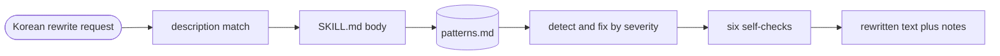

# kor-writing

[](LICENSE)
[](CHANGELOG.md)
<a href="#english"></a>
<a href="#korean"></a>

A Claude Code plugin that removes AI tells from Korean text without changing its content | 내용은 그대로 두고 한국어 글의 AI 티를 걷어내는 Claude Code 플러그인

---

<a id="english"></a>

# English

## Overview

`kor-writing` is a Claude Code plugin for Korean writing. Its skill `kor-deslop` finds AI tells in Korean text (translationese, AI stock phrases, mechanical structure, uniform rhythm, excessive formatting) and fixes only the style, leaving the content untouched. It runs in a single pass with no scripts or subagents, and needs no extra tools.

| Skill | Description |
|---|---|
| `kor-deslop` | Finds and fixes AI tells in Korean text while keeping the content. 79 patterns, single pass, no scripts or subagents |

## Features

- **79 patterns in 11 categories** — 70 patterns in A-J (translationese, English notation, structure and formatting, AI stock phrases, rhythm, modifiers and redundancy, hedging, conjunctions, formal nouns, visual decoration) plus 9 writer principles in K, and a genre table
- **Meaning preservation** — proper nouns, numbers, dates, quotations, code, paths and URLs stay as they are; key nouns per sentence must survive; modality, speech level and genre do not change
- **Severity-based fixing** — S1 is fixed on first occurrence, S2 when it repeats, S3 only when it overlaps another pattern; one or two repeats are kept on purpose
- **Self-check with a change-rate guard** — six checks after the rewrite; above 30% change it warns, above 50% it redoes the rewrite with fewer edits
- **Three output modes** — rewritten text with short notes, a check-only table (pattern ID, sentence, direction), or minimal edits for text that is already natural

## Architecture



Only the skill description is loaded in every session; the body and the pattern table load when the skill runs. See [docs/architecture.md](docs/architecture.md).

## Prerequisites

- Claude Code with plugin support (verified with 2.1.316)
- Python 3 (optional; used for the change-rate check when a shell is available)

## Installation

```bash
# Add the marketplace and install the plugin
claude plugin marketplace add whchoi98/kor-writing
claude plugin install kor-writing@kor-writing
```

No other tools need to be installed.

### Update

```bash
# Fetch the latest version, then run /reload-plugins in open sessions
claude plugin marketplace update kor-writing
```

## Usage

Call the skill directly:

```text
/kor-writing:kor-deslop 다음 글에서 AI 티를 빼 주세요.

급변하는 AI 시대에 있어서 데이터의 중요성은 아무리 강조해도 지나치지 않다고 할 수 있습니다.
```

It also runs automatically on requests such as "AI 티 빼줘", "윤문해줘", "번역투 고쳐줘", "담백하게 다듬어줘", or "점검만 해줘". Spelling-only fixes, translation, and rewrites that add or remove content are out of scope.

| Request | Output |
|---|---|
| Default | Full rewritten text, then up to three lines on what changed; deletion candidates and change-rate warnings listed separately |
| "점검만 해줘" (check only) | A table of pattern ID, sentence, and direction, with no edits |
| Text that is already natural | Only the few spots that were touched |

### Trigger overlap

`kor-deslop` shares trigger phrases with humanize-korean-house and humanize-korean. Keep only one of them enabled in an environment, or call `/kor-writing:kor-deslop` explicitly.

## Project Structure

```text
kor-writing/
  .claude-plugin/
    plugin.json            # Plugin name and version
    marketplace.json       # Marketplace entry (source ./)
  skills/
    kor-deslop/
      SKILL.md             # Priority, meaning-preservation rules, procedure, self-check, output
      references/
        patterns.md        # 79 patterns (A-J 70, K 9) and the genre table
  NOTICE.md                # humanize-korean (MIT) license notice
  docs/                    # Architecture, onboarding, ADRs, runbooks
  tests/                   # Harness and plugin-invariant tests
```

## Testing

```bash
# Hooks, secret patterns, and plugin structure (pattern count, versions, manifests)
bash tests/run-all.sh

# Claude Code manifest and skill validation
claude plugin validate .
```

## Contributing

1. Fork the repository
2. Create your branch (`git checkout -b feat/new-pattern`)
3. Commit changes (`git commit -m 'feat: add pattern C-13 for repeated colons'`)
4. Push to the branch (`git push origin feat/new-pattern`)
5. Open a Pull Request

Run `bash scripts/setup.sh` once after cloning. Changes under `skills/` need a version bump in `.claude-plugin/plugin.json` and a `CHANGELOG.md` entry; see [docs/runbooks/release-plugin.md](docs/runbooks/release-plugin.md).

## License

Released under the [MIT License](LICENSE). Patterns A-J, the meaning-preservation rules, the self-check, and the genre table are condensed and modified from humanize-korean v2.3.2 (MIT); see [NOTICE.md](NOTICE.md).

## Contact

- Maintainer: [WooHyung Choi (@whchoi98)](https://github.com/whchoi98)
- Issues: [github.com/whchoi98/kor-writing/issues](https://github.com/whchoi98/kor-writing/issues)

---

<a id="korean"></a>

# 한국어

## 개요

`kor-writing`은 한국어 글쓰기용 Claude Code 플러그인입니다. 스킬 `kor-deslop`은 한국어 글의 AI 티(번역투, AI 관용구, 기계적 구조, 균일한 리듬, 과잉 서식)를 찾아 내용은 그대로 두고 문체만 고칩니다. 스크립트와 하위 에이전트 없이 한 번에 처리하며 별도 도구 설치가 필요 없습니다.

| Skill | 내용 |
|---|---|
| `kor-deslop` | 한국어 글의 AI 티를 찾아 내용은 그대로 두고 문체만 고칩니다. 패턴 79개, 스크립트와 하위 에이전트 없이 단일 패스 |

## 주요 기능

- **11개 범주의 패턴 79개** — A~J 70개(번역투, 영어 표기, 구조와 서식, AI 관용구, 리듬, 수식과 중복, 완곡, 접속사, 형식명사, 시각 장식)와 작성자 원칙 K 9개, 장르 표
- **의미 보존** — 고유명사, 수치, 날짜, 인용, 코드, 경로, URL은 그대로 두고, 문장마다 핵심 명사를 남기며, 서법과 문체 등급과 장르를 바꾸지 않습니다
- **심각도별 수정** — S1은 처음 나올 때 고치고, S2는 반복될 때, S3는 다른 패턴과 겹칠 때만 고칩니다. 반복 패턴은 일부러 1~2회 남깁니다
- **변경률 기준이 있는 자체 점검** — 윤문 후 6개 항목을 확인하고, 변경률이 30%를 넘으면 경고하고 50%를 넘으면 수정을 줄여 다시 만듭니다
- **세 가지 결과 전달 방식** — 고친 글과 짧은 메모, 점검만 하는 표(패턴 ID, 문장, 고칠 방향), 이미 자연스러운 글에는 최소 수정

## 아키텍처


매 세션에는 스킬 설명만 로드되고, 본문과 패턴 표는 스킬이 실행될 때 로드됩니다. 자세한 내용은 [docs/architecture.md](docs/architecture.md)를 참고합니다.

## 사전 요구 사항

- 플러그인을 지원하는 Claude Code(2.1.316에서 검증)
- Python 3(선택 사항, 셸을 쓸 수 있을 때 변경률 점검에 사용)

## 설치 방법

```bash
# Add the marketplace and install the plugin
claude plugin marketplace add whchoi98/kor-writing
claude plugin install kor-writing@kor-writing
```

별도 도구 설치는 필요 없습니다.

### 갱신

```bash
# Fetch the latest version, then run /reload-plugins in open sessions
claude plugin marketplace update kor-writing
```

## 사용법

스킬을 직접 호출합니다.

```text
/kor-writing:kor-deslop 다음 글에서 AI 티를 빼 주세요.

급변하는 AI 시대에 있어서 데이터의 중요성은 아무리 강조해도 지나치지 않다고 할 수 있습니다.
```

"AI 티 빼줘", "윤문해줘", "번역투 고쳐줘", "담백하게 다듬어줘", "점검만 해줘" 같은 요청에도 자동으로 실행됩니다. 맞춤법만 고치는 요청, 번역, 내용을 더하거나 빼는 재작성은 대상이 아닙니다.

| 요청 | 결과 |
|---|---|
| 기본 | 고친 글 전체와 바뀐 점 세 줄 이내. 삭제 후보와 변경률 경고는 따로 표시 |
| "점검만 해줘" | 고치지 않고 패턴 ID, 해당 문장, 고치는 방향을 표로 나열 |
| 이미 자연스러운 글 | 손댄 곳만 알림 |

### 트리거 중복

humanize-korean-house나 humanize-korean과 트리거 문구가 겹치므로 한 환경에서는 하나만 켜 두는 편이 좋습니다. 또는 `/kor-writing:kor-deslop`으로 직접 호출합니다.

## 프로젝트 구조

```text
kor-writing/
  .claude-plugin/
    plugin.json            # 플러그인 이름과 버전
    marketplace.json       # 마켓플레이스 항목 (source ./)
  skills/
    kor-deslop/
      SKILL.md             # 우선순위, 의미 보존 규칙, 절차, 자체 점검, 결과 전달
      references/
        patterns.md        # 패턴 79개(A~J 70개, K 9개)와 장르 표
  NOTICE.md                # humanize-korean(MIT) 라이선스 고지
  docs/                    # 아키텍처, 온보딩, ADR, 런북
  tests/                   # 하네스와 플러그인 불변 조건 테스트
```

## 테스트

```bash
# Hooks, secret patterns, and plugin structure (pattern count, versions, manifests)
bash tests/run-all.sh

# Claude Code manifest and skill validation
claude plugin validate .
```

## 기여 방법

1. 저장소를 Fork합니다
2. 브랜치를 만듭니다 (`git checkout -b feat/new-pattern`)
3. 변경 사항을 커밋합니다 (`git commit -m 'feat: add pattern C-13 for repeated colons'`)
4. 브랜치에 Push합니다 (`git push origin feat/new-pattern`)
5. Pull Request를 엽니다

clone한 뒤 `bash scripts/setup.sh`를 한 번 실행합니다. `skills/` 아래를 바꾸면 `.claude-plugin/plugin.json`의 버전을 올리고 `CHANGELOG.md`에 항목을 추가해야 합니다. [docs/runbooks/release-plugin.md](docs/runbooks/release-plugin.md)를 참고합니다.

## 라이선스

[MIT License](LICENSE)로 배포합니다. A~J 패턴, 의미 보존 규칙, 자체 점검, 장르 표는 humanize-korean v2.3.2(MIT)를 압축하고 수정한 것입니다. [NOTICE.md](NOTICE.md)를 참고합니다.

## 연락처

- 관리자: [WooHyung Choi (@whchoi98)](https://github.com/whchoi98)
- 이슈: [github.com/whchoi98/kor-writing/issues](https://github.com/whchoi98/kor-writing/issues)
