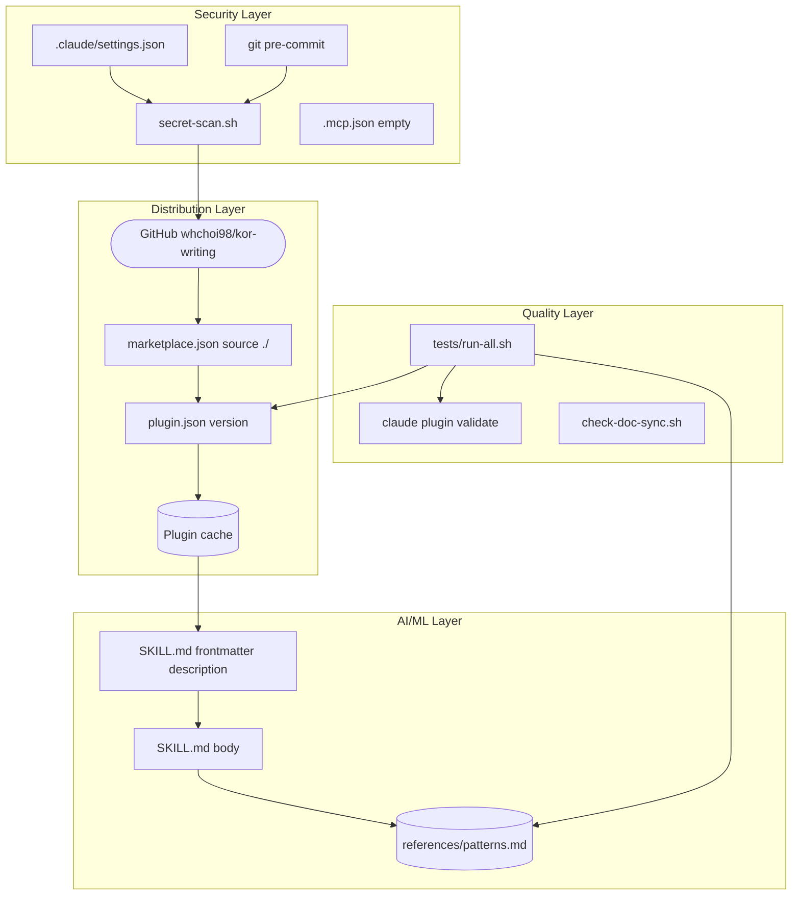
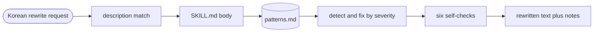
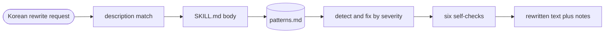

# Architecture

---

# English

## System Overview

`kor-writing` is a documentation-only Claude Code plugin that ships one skill, `kor-deslop`.
Claude Code loads the skill's frontmatter in every session, matches Korean rewrite requests against its
`description`, then loads the skill body and reads a 79-pattern rulebook to rewrite the text in a single pass.
The same GitHub repository serves as the marketplace, the plugin, and the development harness.

## Components

### Distribution Layer
- **.claude-plugin/marketplace.json** -- Marketplace `kor-writing` with one plugin entry whose `source` is `./`. This is why the install id is `kor-writing@kor-writing`.
- **.claude-plugin/plugin.json** -- Name, version (1.0.0), license (MIT). The version is the update signal for installed copies.
- **GitHub whchoi98/kor-writing** -- Public repo; `claude plugin marketplace add whchoi98/kor-writing` clones it into the local marketplace cache.

### AI/ML Layer
- **skills/kor-deslop/SKILL.md** -- Frontmatter `description` is the trigger (always loaded). The body fixes the rule priority, meaning-preservation rules, a five-step procedure, six self-checks, and three output modes.
- **skills/kor-deslop/references/patterns.md** -- A-J (70 patterns with S1-S3 severity), K writer principles (9), and a genre table. Read once per run.
- **NOTICE.md** -- MIT notice for humanize-korean v2.3.2, the source of the A-J taxonomy.

### Security Layer
- **.claude/settings.json** -- Deny list, empty commit/PR attribution, hook registration (dev only).
- **.claude/hooks/secret-scan.sh** -- Blocks `git commit` tool calls (exit 2) and, through the git `pre-commit` hook, staged files with secret-like strings. Scans Markdown.
- **.mcp.json** -- Kept empty because it is also read as the plugin's MCP configuration.

### Quality Layer
- **tests/run-all.sh** -- Harness and plugin-invariant tests: pattern count, version sync, frontmatter, no shipped executable components, bilingual docs.
- **.claude/hooks/check-doc-sync.sh** -- After edits, reminds about module docs, ADRs, version bumps, and pattern-count updates.

## Full Architecture Diagram

## Data Flow Summary

## Packaging

| Path | Role | Ships to users | Loaded by Claude Code for users |
|------|------|----------------|---------------------------------|
| `.claude-plugin/` | Manifests | Yes | Yes |
| `skills/kor-deslop/` | The skill | Yes | Yes (description always, body on invoke) |
| `.mcp.json` | Empty MCP config | Yes | Yes (no servers) |
| `NOTICE.md`, `LICENSE`, `README.md`, `CHANGELOG.md` | Legal and docs | Yes | No |
| `skills/CLAUDE.md` | Module doc | Yes | No (not a skill directory) |
| `.claude/`, `docs/`, `scripts/`, `tests/`, `CLAUDE.md` | Dev harness | Yes | No (only active when this repo is the working directory) |

## Key Design Decisions

- Single pass with an on-demand rulebook instead of a multi-agent pipeline -- keeps the always-on cost near 260 tokens and ships no executable code ([ADR-001](decisions/ADR-001-single-pass-skill-with-on-demand-rulebook.md)).
- One repository as marketplace and plugin (`source: ./`) -- one push publishes; the cost is that every root file ships, so dev tooling stays under `.claude/` and root component paths are forbidden by tests.
- Permanent pattern IDs with the upstream A-17 gap preserved -- users and docs can cite IDs across versions.
- Rule priority fixed as user request, then meaning preservation, then patterns -- a pattern never overrides the user's format or the content.
- Secret scanning includes Markdown -- the repo is almost all Markdown and public.

## Operations
- Release: see [docs/runbooks/release-plugin.md](runbooks/release-plugin.md)
- Local setup and testing: see [docs/onboarding.md](onboarding.md)

---

# 한국어

## 시스템 개요

`kor-writing`은 스킬 `kor-deslop` 하나를 담은, 문서로만 구성된 Claude Code 플러그인입니다.
Claude Code는 매 세션 스킬의 frontmatter를 로드하고 한국어 윤문 요청을 `description`과 대조한 뒤, 스킬 본문을 로드하고 패턴 79개 규칙집을 읽어 한 번에 글을 고칩니다.
같은 GitHub 저장소가 마켓플레이스, 플러그인, 개발 하네스 역할을 함께 합니다.

## 구성 요소

### Distribution Layer
- **.claude-plugin/marketplace.json** -- 마켓플레이스 `kor-writing`에 `source`가 `./`인 플러그인 항목 하나가 있습니다. 그래서 설치 식별자가 `kor-writing@kor-writing`입니다.
- **.claude-plugin/plugin.json** -- 이름, 버전(1.0.0), 라이선스(MIT). 버전이 설치된 사본의 갱신 신호입니다.
- **GitHub whchoi98/kor-writing** -- 공개 저장소입니다. `claude plugin marketplace add whchoi98/kor-writing`이 로컬 마켓플레이스 캐시로 복제합니다.

### AI/ML Layer
- **skills/kor-deslop/SKILL.md** -- frontmatter `description`이 트리거입니다(항상 로드). 본문은 규칙 우선순위, 의미 보존 규칙, 5단계 절차, 자체 점검 6항목, 결과 전달 방식 3가지를 정합니다.
- **skills/kor-deslop/references/patterns.md** -- A~J(심각도 S1~S3가 붙은 패턴 70개), K 작성자 원칙(9개), 장르 표. 실행할 때 한 번 읽습니다.
- **NOTICE.md** -- A~J 분류 체계의 출처인 humanize-korean v2.3.2의 MIT 고지입니다.

### Security Layer
- **.claude/settings.json** -- 거부 목록, 비어 있는 커밋/PR attribution, hook 등록(개발용).
- **.claude/hooks/secret-scan.sh** -- `git commit` 도구 호출(exit 2)과, git `pre-commit` hook을 통해 비밀값처럼 보이는 문자열이 든 staged 파일을 차단합니다. Markdown도 검사합니다.
- **.mcp.json** -- 플러그인의 MCP 설정으로도 읽히므로 비워 둡니다.

### Quality Layer
- **tests/run-all.sh** -- 하네스와 플러그인 불변 조건 테스트입니다. 패턴 개수, 버전 일치, frontmatter, 배포되는 실행 컴포넌트 부재, 이중 언어 문서를 확인합니다.
- **.claude/hooks/check-doc-sync.sh** -- 편집 후 모듈 문서, ADR, 버전 올리기, 패턴 개수 갱신을 알려 줍니다.

## 전체 아키텍처 다이어그램

## 데이터 흐름 요약

## 패키징

| Path | Role | Ships to users | Loaded by Claude Code for users |
|------|------|----------------|---------------------------------|
| `.claude-plugin/` | Manifests | Yes | Yes |
| `skills/kor-deslop/` | The skill | Yes | Yes (description always, body on invoke) |
| `.mcp.json` | Empty MCP config | Yes | Yes (no servers) |
| `NOTICE.md`, `LICENSE`, `README.md`, `CHANGELOG.md` | Legal and docs | Yes | No |
| `skills/CLAUDE.md` | Module doc | Yes | No (not a skill directory) |
| `.claude/`, `docs/`, `scripts/`, `tests/`, `CLAUDE.md` | Dev harness | Yes | No (only active when this repo is the working directory) |

## 주요 설계 결정

- 다중 에이전트 파이프라인 대신 필요할 때 읽는 규칙집과 단일 패스를 씁니다 -- 상시 비용을 260 토큰 안팎으로 유지하고 실행 코드를 배포하지 않습니다([ADR-001](decisions/ADR-001-single-pass-skill-with-on-demand-rulebook.md)).
- 저장소 하나가 마켓플레이스이자 플러그인입니다(`source: ./`) -- push 한 번으로 배포됩니다. 대신 루트 파일이 모두 배포되므로 개발 도구는 `.claude/` 아래에 두고, 루트의 컴포넌트 경로는 테스트로 막습니다.
- 패턴 ID는 영구적이며 원본의 A-17 공백을 유지합니다 -- 사용자와 문서가 버전이 바뀌어도 같은 ID를 인용할 수 있습니다.
- 규칙 우선순위는 사용자 요청, 의미 보존, 패턴 순으로 고정합니다 -- 패턴이 사용자의 형식이나 내용을 덮어쓰지 않습니다.
- 비밀값 검사에 Markdown을 포함합니다 -- 저장소가 거의 전부 Markdown이고 공개되어 있습니다.

## 운영
- 배포: [docs/runbooks/release-plugin.md](runbooks/release-plugin.md) 참고
- 로컬 설정과 테스트: [docs/onboarding.md](onboarding.md) 참고
